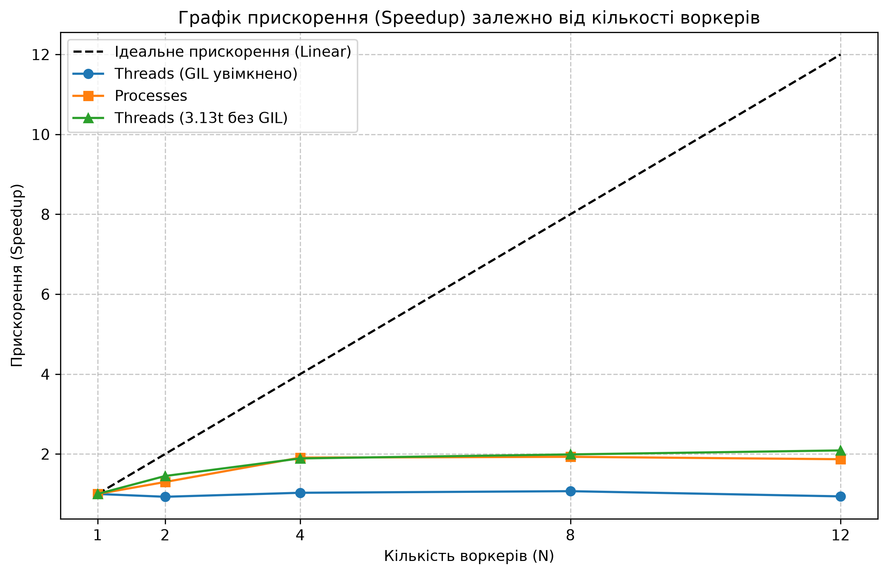

# Лабораторна робота №5. Конкурентність і GIL: потоки, процеси і паралельна індексація

## Опис завдання
**Що вивчаємо:** 
Конкурентність і паралелізм; робота, обмежена процесором (CPU-bound), і робота, обмежена вводом-виводом (I/O-bound); вплив GIL (що він блокує в інтерпретаторі і яких інваріантів не захищає); бібліотеки `threading`, `multiprocessing` і `concurrent.futures`; ціна передачі даних через `pickle`; закон Амдала; експериментальна збірка Python 3.13t без GIL.

**Що зроблено в межах проєкту (Map-Reduce):**
1. Функцію `build_index` розділено на `build_partial` (рівня модуля для ізольованої роботи) та `merge`.
2. Реалізовано передачу шляхів до файлів у воркери з унікальними діапазонами `doc_id`.
3. Додано підтримку прапорців `--workers N` та `--executor {serial,threads,processes}` через `concurrent.futures`.
4. Налаштовано безпечний запуск процесів через метод `spawn` із миттєвим перехопленням падінь воркерів.
5. Зібрано метрики продуктивності (wall time, CPU time, Peak RSS) за допомогою утиліти `/usr/bin/time -v`.
6. Проведено тестування масштабованості потоків на збірці Python 3.13t із вимкненим GIL.

---

## Характеристики тестового стенду
* **Процесор:** 11th Gen Intel(R) Core(TM) i5-11400F @ 2.60GHz
* **Ядра:** 6 фізичних / 12 логічних (`os.cpu_count() = 12`)

## Результати бенчмарків

| Екзекутор / Версія Python | Воркери (N) | Wall Time (с) | CPU Time (с) | Peak RSS (MB) | Merge Time (с) | Прискорення (Speedup) |
| :--- | :---: | :---: | :---: | :---: | :---: | :---: |
| **Serial** (1 потік) | 1 | 27.22 | 27.12 | 3078 | 0.36 | **1.00x** (еталон) |
| **Threads** (GIL увімкнено) | 2 | 29.48 | 29.36 | 2303 | 0.55 | 0.93x |
| **Threads** (GIL увімкнено) | 4 | 26.51 | 30.09 | 3073 | 0.66 | 1.03x |
| **Threads** (GIL увімкнено) | 8 | 25.33 | 28.88 | 3130 | 0.65 | 1.07x |
| **Threads** (GIL увімкнено) | 12 | 28.89 | 32.87 | 3169 | 0.79 | 0.94x |
| **Processes** | 2 | 20.95 | 35.60 | 1820 | 0.45 | 1.30x |
| **Processes** | 4 | 14.18 | 39.14 | 1099 | 0.66 | 1.91x |
| **Processes** | 8 | 14.11 | 38.84 | 1099 | 0.67 | 1.93x |
| **Processes** | 12 | 14.52 | 40.08 | 1099 | 0.71 | 1.87x |
| **Threads** (3.13t без GIL)| 2 | 18.73 | 30.86 | 3002 | 0.66 | 1.45x |
| **Threads** (3.13t без GIL)| 4 | 14.36 | 37.32 | 3812 | 0.90 | 1.89x |
| **Threads** (3.13t без GIL)| 8 | 13.63 | 35.75 | 4036 | 0.89 | 1.99x |
| **Threads** (3.13t без GIL)| 12 | 12.99 | 34.31 | 3685 | 0.79 | 2.09x |

*(Усі значення Wall Time, CPU Time, Peak RSS та Merge Time є медіаною з 3-х послідовних запусків. CPU Time = User Time + System Time)*

## Графік прискорення

### Інструкція з запуску

**1. Побудова індексу**
# Багатопроцесорний запуск
`bash`
uv run findex index data/ index.bin --executor processes --workers 4

# Багатопотоковий запуск
`bash`
uv run findex index data/ index.bin --executor threads --workers 8

# Послідовний запуск
`bash`
uv run findex index data/ index.bin --executor serial

**2. Замір метрик (Wall time, Peak RSS):**
`bash`
/usr/bin/time -v uv run findex index data/ index.bin --executor processes --workers 4

**3. Тестування без GIL (Python 3.13t):**
`bash`
uv run --python 3.13t findex index data/ index.bin --executor threads --workers 8

