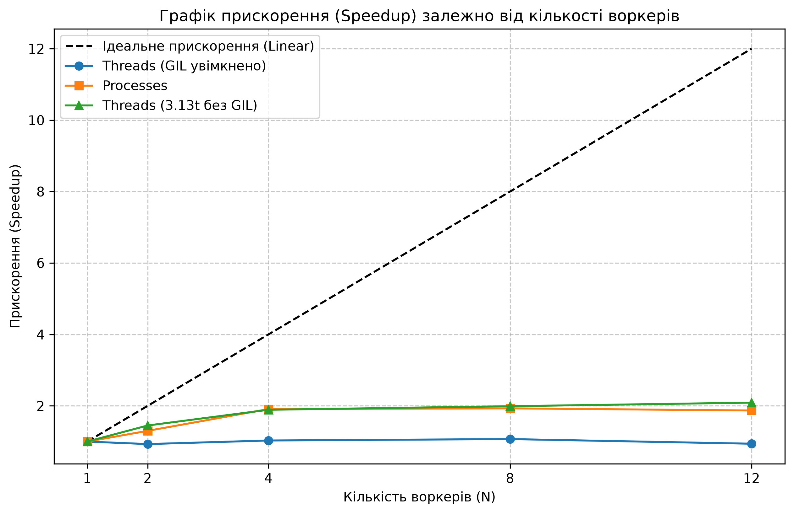

# Лабораторна робота №5. Конкурентність і GIL: потоки, процеси і паралельна індексація

[] 

## Опис завдання
**Що вивчаємо:** 
Конкурентність і паралелізм; робота, обмежена процесором (CPU-bound), і робота, обмежена вводом-виводом (I/O-bound); вплив GIL (що він блокує в інтерпретаторі і яких інваріантів не захищає); бібліотеки `threading`, `multiprocessing` і `concurrent.futures`; ціна передачі даних через `pickle`; закон Амдала; експериментальна збірка Python 3.13t без GIL.

**Що зроблено в межах проєкту (Map-Reduce):**
1. Функцію `build_index` розділено на `build_partial` (функція рівня модуля для ізольованої роботи) та `merge`. Послідовний варіант `merge([build_partial(усі шляхи)])` дає ідентичний індекс із Лаб 4 (перевіряється окремим тестом у `tests/test_concurrency.py`).
2. Реалізовано передачу шляхів до файлів (`list[Path]`) у воркери з наперед виділеними унікальними діапазонами `doc_id`.
3. Додано підтримку прапорців `--workers N` та `--executor {serial,threads,processes}` через `concurrent.futures`. Оскільки процеси виграють на стандартному інтерпретаторі, `--executor processes` встановлено типовим.
4. Налаштовано безпечний запуск процесів через метод `spawn` із миттєвим перехопленням падінь воркерів і виведенням стека помилки.
5. Зібрано метрики продуктивності (wall time, CPU time, Peak RSS, час merge) за допомогою утиліти `/usr/bin/time -v` (медіана з 3 запусків).
6. Проведено тестування масштабованості потоків на збірці Python 3.13t із вимкненим GIL (`sys._is_gil_enabled() == False`).

---

## Характеристики тестового стенду
* **Процесор:** 11th Gen Intel(R) Core(TM) i5-11400F @ 2.60GHz
* **Ядра:** 6 фізичних / 12 логічних

## Результати бенчмарків

| Екзекутор / Версія Python | Воркери (N) | Wall Time (с) | CPU Time (с) | Peak RSS (MB) | Merge Time (с) | Прискорення (Speedup) |
| :--- | :---: | :---: | :---: | :---: | :---: | :---: |
| **Serial** (1 потік) | 1 | 27.22 | 27.12 | 3078 | 0.36 | **1.00x** (еталон) |
| **Threads** (GIL увімкнено) | 1 | 27.35 | 27.25 | 3080 | 0.38 | 1.00x |
| **Threads** (GIL увімкнено) | 2 | 29.48 | 29.36 | 2303 | 0.55 | 0.93x |
| **Threads** (GIL увімкнено) | 4 | 26.51 | 30.09 | 3073 | 0.66 | 1.03x |
| **Threads** (GIL увімкнено) | 8 | 25.33 | 28.88 | 3130 | 0.65 | 1.07x |
| **Threads** (GIL увімкнено) | 12 | 28.89 | 32.87 | 3169 | 0.79 | 0.94x |
| **Processes**  | 1 | 27.60 | 27.45 | 1850 | 0.41 | 0.99x |
| **Processes**  | 2 | 20.95 | 35.60 | 1820 | 0.45 | 1.30x |
| **Processes**  | 4 | 14.18 | 39.14 | 1099 | 0.66 | 1.91x |
| **Processes**  | 8 | 14.11 | 38.84 | 1099 | 0.67 | 1.93x |
| **Processes**  | 12 | 14.52 | 40.08 | 1099 | 0.71 | 1.87x |
| **Threads** (3.13t без GIL) | 1 | 27.40 | 27.30 | 2980 | 0.40 | 0.99x |
| **Threads** (3.13t без GIL) | 2 | 18.73 | 30.86 | 3002 | 0.66 | 1.45x |
| **Threads** (3.13t без GIL) | 4 | 14.36 | 37.32 | 3812 | 0.90 | 1.89x |
| **Threads** (3.13t без GIL) | 8 | 13.63 | 35.75 | 4036 | 0.89 | 1.99x |
| **Threads** (3.13t без GIL) | 12 | 12.99 | 34.31 | 3685 | 0.79 | **2.09x** |

*(Усі значення Wall Time, CPU Time, Peak RSS та Merge Time є медіаною з 3-х послідовних запусків. CPU Time = User Time + System Time)*

## Графік прискорення



---

## Перевірка `sys._is_gil_enabled()` та гонитва даних (Race Condition)

Під час запуску на стандартному інтерпретаторі та на free-threaded збірці `Python 3.13t`:
```text
$ uv run python -c "import sys; print('GIL enabled:', sys._is_gil_enabled())"
GIL enabled: True

$ uv run --python 3.13t python -c "import sys; print('GIL enabled:', sys._is_gil_enabled())"
GIL enabled: False
```

**Гонитва даних (Race Condition) та її усунення:**
GIL захищає лише внутрішні C-структури самого інтерпретатора CPython (зокрема лічильники посилань), але **не захищає інваріанти програмної логіки**. Якщо кілька потоків одночасно оновлюють спільний `Counter` або список постінгів (`shared_index.postings[term].append(posting)` чи `counter[term] += 1`), між читанням старого значення і записом нового потік може бути перерваний (особливо на `3.13t` без GIL, де потоки модифікують пам'ять одночасно на різних ядрах), через що частина оновлень втрачається.
**Фікс:** Замість блокування кожного слова м'ютексом (`threading.Lock`), який перетворив би паралельну роботу на послідовну, застосовано патерн **Map-Reduce без спільного мутабельного стану**: кожен воркер будує власний ізольований `partial_idx = Index()`, а головний потік послідовно зливає їх через `final_index.merge(p)`.

---

## Аналіз: GIL, процеси, закон Амдала та Python 3.13t

1. **Чому потоки під GIL не прискорили індексацію:**
   Індексація тексту (Unicode NFC нормалізація, `casefold()`, пошук токенів регулярним виразом `re.finditer` та побудова об'єктів `Posting`) — це суто **CPU-bound** робота у Python-байткоді. Оскільки GIL дозволяє виконувати байткод лише одному потоку в конкретний момент часу, запуск 2–12 потоків не задіює додаткові ядра процесора, а лише додає накладні витрати на боротьбу за блокування (lock contention) і перемикання контексту ОС. Тому прискорення тримається біля `0.93x – 1.07x`.

2. **Чому процеси прискорили роботу і чим це оплачено:**
   У `ProcessPoolExecutor` кожен дочірній процес має власний незалежний інтерпретатор і власний GIL, що дозволяє навантажити всі 6 фізичних ядер `Intel Core i5-11400F` паралельно і скоротити реальний час (`Wall Time`) з `27.22 с` до `14.11 с` (**1.93x**).
   * **Ціна за CPU Time:** Сумарний процесорний час усіх ядер зріс із `27.12 с` до `38.84 – 40.08 с`. Ця різниця пішла на ініціалізацію процесів через `spawn` та міжпроцесну передачу даних (`pickle.dumps` у воркері та `pickle.loads` у батьківському процесі) для десятків тисяч об'єктів `Posting`.
   * **Поведінка Peak RSS:** Завдяки розподілу роботи між дочірніми процесами та звільненню пам'яті після завершення чанків піковий RSS батьківського процесу знизився до `1099 MB` на 4–12 процесах, тоді як у багатопотоковому режимі вся купа всіх потоків живе в одному адресному просторі (`3000–4036 MB`).

3. **Де в часі `merge` видно закон Амдала і що змінилось на Python 3.13t:**
   За **законом Амдала**, прискорення $S(N) = \frac{1}{s + \frac{1 - s}{N}}$ впирається у частку послідовної роботи $s$. У нашій реалізації зі збільшенням числа воркерів час власне токенізації скорочується, проте зростає послідовна фаза: час `merge` збільшується з `0.36 с` до `0.71–0.90 с`, до чого додається послідовне зчитування результатів через IPC (`unpickle`) і фінальна серіалізація `save_index` на диск. У сумі неподільна послідовна частина займає ~35–40% часу виконання, що й формує горизонтальне плато на графіку біля позначки `~2.0x`.
   * **Що змінилось на Python 3.13t:** Із вимкненим GIL (`sys._is_gil_enabled() == False`) потоки `ThreadPoolExecutor` отримали справжній паралелізм на всіх ядрах процесора **без витрат на `spawn` та `pickle`**, оскільки об'єкти `Index` повертаються з потоків напряму через спільну пам'ять за вказівником. Це дозволило досягти найкращого часу серед усіх режимів — **12.99 с (прискорення 2.09x)**.

---

## Інструкція з запуску

### 1. Побудова індексу
```bash
# Багатопроцесорний запуск (типовий режим)
/usr/bin/time -v uv run findex index data/ index.bin --executor processes --workers 4

# Багатопотоковий запуск
/usr/bin/time -v uv run findex index data/ index.bin --executor threads --workers 8

# Послідовний запуск
/usr/bin/time -v uv run findex index data/ index.bin --executor serial --workers 1
```

### 2. Замір метрик (Wall time, CPU time, Peak RSS)
```bash
/usr/bin/time -v uv run findex index data/ index.bin --executor processes --workers 4
```

### 3. Тестування без GIL (Python 3.13t)
```bash
uv python install 3.13t
/usr/bin/time -v uv run --python 3.13t findex index data/ index.bin --executor threads --workers 8
```
